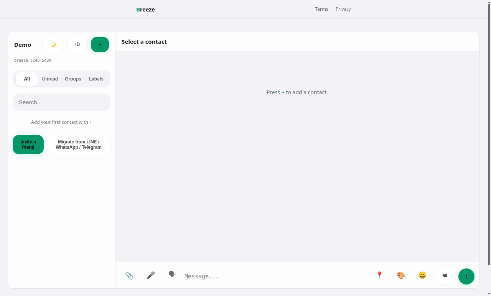

# Breeze Messenger

[](../../LICENSE)

**ఇతర భాషల్లో చదవండి**: [日本語](../../README.md) · [English](README-en.md) · [中文（简体）](README-zh-CN.md) · [中文（繁體）](README-zh-TW.md) · [Español](README-es.md) · [Français](README-fr.md) · [Deutsch](README-de.md) · [Italiano](README-it.md) · [Português (Brasil)](README-pt-BR.md) · [Русский](README-ru.md) · [Українська](README-uk.md) · [Polski](README-pl.md) · [Nederlands](README-nl.md) · [Svenska](README-sv.md) · [Norsk](README-nb.md) · [Dansk](README-da.md) · [Suomi](README-fi.md) · [Čeština](README-cs.md) · [Magyar](README-hu.md) · [Română](README-ro.md) · [Ελληνικά](README-el.md) · [Türkçe](README-tr.md) · [العربية](README-ar.md) · [فارسی](README-fa.md) · [עברית](README-he.md) · [हिन्दी](README-hi.md) · [বাংলা](README-bn.md) · [اردو](README-ur.md) · [ਪੰਜਾਬੀ](README-pa.md) · [தமிழ்](README-ta.md) · తెలుగు (ఈ పేజీ) · [മലയാളം](README-ml.md) · [Bahasa Indonesia](README-id.md) · [Bahasa Melayu](README-ms.md) · [Tiếng Việt](README-vi.md) · [ไทย](README-th.md) · [မြန်မာ](README-my.md) · [ខ្មែរ](README-km.md) · [한국어](README-ko.md) · [Filipino](README-tl.md) · [Kiswahili](README-sw.md) · [Hausa](README-ha.md) · [Yorùbá](README-yo.md) · [Igbo](README-ig.md) · [አማርኛ](README-am.md) · [ქართული](README-ka.md) · [Azərbaycan](README-az.md) · [Қазақша](README-kk.md) · [Oʻzbek](README-uz.md) · [Српски](README-sr.md) · [Hrvatski](README-hr.md)

**ఫోన్ నంబర్ లేదా రిజిస్ట్రేషన్ అవసరం లేని ఎన్‌క్రిప్ట్ చేయబడిన మెసెంజర్.**
సంభాషణలోని విషయాన్ని పంపినవారు మరియు స్వీకరించేవారు మాత్రమే చదవగలరు. మధ్యలో దానిని తీసుకెళ్లే సర్వర్ కూడా దానిని చదవలేదు.
అన్ని ఫీచర్లు ఉచితం, ప్రకటనలు లేవు.

ఇది వెబ్ పేజీ కాదు — ఇది ఇన్‌స్టాల్ చేసి ఉపయోగించే సాఫ్ట్‌వేర్ (Windows / Mac / Linux / Android / iPhone / బ్రౌజర్).



## దీన్ని ఉపయోగించడానికి, దీన్ని మీ స్వంత సర్వర్‌లో హోస్ట్ చేయండి

Breeze కు "కంపెనీ సర్వర్" లేదు. **దీన్ని ఉపయోగించడానికి, మీరు స్వయంగా హోస్టింగ్ స్థలాన్ని (సర్వర్‌ను) సిద్ధం చేసి, అక్కడ Breeze ను ఉంచాలి. దీన్ని ఉపయోగించడానికి ఇదే అధికారిక మార్గం.**

- ప్రామాణిక సెటప్ Cloudflare ను ఉపయోగిస్తుంది, కాబట్టి **Cloudflare ఖాతా అవసరం**. దశలు [సెటప్ గైడ్](SELF_HOSTING-te.md) లో ఉన్నాయి (ఇతర భాషలను గైడ్ పైభాగం నుండి ఎంచుకోవచ్చు).
- యాప్‌ను (Windows / Mac / Linux / Android / iPhone) [డౌన్‌లోడ్ పేజీ](https://github.com/shizukutanaka/Breeze/releases/latest) నుండి పొంది, దానిని మీ స్వంత సర్వర్‌కు కనెక్ట్ చేసి ఉపయోగించండి.
- **డెమో హోస్ట్ గురించి (నిజాయితీతో కూడిన గమనిక)**: ప్రయత్నించడానికి ఒక డెమో (https://breeze-469.pages.dev/) అందుబాటులో ఉంది. ఇది అదే సాఫ్ట్‌వేర్, కానీ వాస్తవ ఉపయోగం కోసం దయచేసి మీ స్వంత సర్వర్‌ను ఉపయోగించండి. డెమో నోటీసు లేకుండా మారవచ్చు లేదా ఆగిపోవచ్చు. మీ స్వంత సర్వర్‌లో హోస్ట్ చేయబడిన Breeze డెమో నిలిపివేత వల్ల ప్రభావితం కాదు.

వివరణాత్మక వినియోగ సూచనల కోసం, [మాన్యువల్](MANUAL-te.md) చూడండి (ఇతర భాషలను మాన్యువల్ పైభాగం నుండి ఎంచుకోవచ్చు).

## ఎలా ఉపయోగించాలి (3 దశలు)

1. మీ స్వంత సర్వర్‌లో హోస్ట్ చేయబడిన Breeze ను (లేదా దానిని హోస్ట్ చేసిన వ్యక్తి మీకు ఇచ్చిన చిరునామాను) తెరిచి, "యాదృచ్ఛిక ID తో ప్రారంభించండి" నొక్కండి (కావాలంటే పేరు నమోదు చేయవచ్చు). అంతే — మీరు సిద్ధంగా ఉన్నారు (రిజిస్ట్రేషన్ లేదు, ఫోన్ నంబర్ లేదు). ఈ సమయంలో, మీ పరికరం లోపల ఒక "కీ" సృష్టించబడుతుంది, ఆ కీ మీ గుర్తింపు అవుతుంది.
2. మీరు మాట్లాడాలనుకునే వ్యక్తికి మీ ID లేదా QR కోడ్ ఇవ్వండి.
3. మరొక వ్యక్తి వద్ద కూడా యాప్ తెరిచి ఉంటే, మీరు నేరుగా కనెక్ట్ అయి మాట్లాడవచ్చు. వారి వద్ద అది తెరిచి లేనప్పుడు, మీ సందేశం ఎన్‌క్రిప్ట్ చేయబడిన రూపంలో ఒక "మెయిల్‌బాక్స్" లో ఉంచబడుతుంది మరియు వారు దానిని తెరిచినప్పుడు డెలివర్ చేయబడుతుంది. మెయిల్‌బాక్స్‌ను తీసుకెళ్లే సర్వర్ విషయాన్ని చదవలేదు. ఎప్పటికీ డెలివర్ కాని లేఖలు గరిష్ఠంగా 7 రోజుల తర్వాత స్వయంచాలకంగా తొలగించబడతాయి.

## వాగ్దానాలు (మేము చేయనివి)

- **ప్రకటనలు లేవు.** యాప్‌లో ఎక్కడా లేదు, ఎక్కడా లేదు.
- **ట్రాకింగ్ లేదు.** వినియోగ విశ్లేషణ లేదు, ప్రకటనల యంత్రాంగం లేదు, డేటా అమ్మకం లేదు.
- **సృష్టికర్త వద్ద వినియోగదారుల డేటా ఏదీ లేదు.** సర్వర్ వైపు ఖాతాల జాబితాయే లేదు. మీ గుర్తింపు అనేది మీ పరికరం లోపల ఉన్న కీ మాత్రమే.
- **సంభాషణలు పరికరాల మధ్య ఎన్‌క్రిప్ట్ చేయబడతాయి.** సర్వర్ నిర్వహించేది అది చదవలేని కవర్లు మాత్రమే.

పరిధిని కూడా మేము నిజాయితీగా వ్రాస్తాము. డెలివరీ కోసం, సర్వర్‌లో స్వల్పకాలిక నిలుపుదల ఉంటుంది (డెలివర్ కాని కవర్లు గరిష్ఠంగా 7 రోజులు, కనెక్షన్ సిగ్నల్స్ 5 నిమిషాలు, చిరునామా మరియు పరికర రికార్డులు 90 రోజులు, సమూహ సమాచారం మరియు నోటిఫికేషన్ సభ్యత్వాలు 30 రోజులు నిలుపబడతాయి. ఇవన్నీ స్వయంచాలకంగా తొలగించబడతాయి, విషయాన్ని చదవలేము). క్లౌడ్ బ్యాకప్ డిఫాల్ట్‌గా నిలిపివేయబడింది. మీరు దీన్ని మీ స్వంత సర్వర్‌లో హోస్ట్ చేస్తే, ఆ నిలుపుదల కూడా మీ స్వంత నియంత్రణలోకి వస్తుంది.

## మీరు ఏమి చేయవచ్చు

- ఒకరితో ఒకరు సంభాషణలు మరియు సమూహ సంభాషణలు (గరిష్ఠంగా 1,000 మంది)
- వాయిస్ కాల్‌లు మరియు వీడియో కాల్‌లు (సమూహ కాల్‌లు గరిష్ఠంగా 8 మంది)
- కాల్ చరిత్ర (ఈ పరికరంలో మాత్రమే ఉంచబడుతుంది: ఇతర వ్యక్తి, దిశ, సమయం మరియు కాల్ వ్యవధి మాత్రమే — మాట్లాడినదాంట్లో ఏదీ లేదు. ఎప్పుడూ సర్వర్‌కు లేదా ఇతర వ్యక్తికి పంపబడదు)
- ఫైల్ పంపడం (ఒకరితో ఒకరికి గరిష్ఠంగా 50MB. సమూహాలలో కూడా పంపవచ్చు, కానీ పరిమాణ పరిమితి చిన్నది)
- బహుళ పరికరాలు మరియు బహుళ ఖాతాలను ఉపయోగించడం (ఉదా. పని కోసం మరియు వ్యక్తిగత ఉపయోగం కోసం. పరికరాల సంఖ్య మరియు ఖాతాల సంఖ్య ఉచితం మరియు అపరిమితం)
- స్వయంచాలక బ్యాకప్ (ఏదైనా మారినప్పుడు, ఎన్‌క్రిప్ట్ చేయబడిన బ్యాకప్ స్వయంచాలకంగా మీ స్వంత సర్వర్‌లో సేవ్ అవుతుంది. కొత్త పరికరంలో, మీ గుర్తింపును పునరుద్ధరించిన తర్వాత, బ్యాకప్ స్వయంచాలకంగా కనుగొనబడి మీకు అందించబడుతుంది. కొత్త పరికరానికి తరలించడానికి సెట్టింగ్‌లలో మార్గదర్శకత్వం కూడా ఉంది)
- ప్రతి కాంటాక్ట్ కోసం మీరు ఎంచుకునే పేరు (మీరు ప్రతి కాంటాక్ట్ పేరును మార్చవచ్చు, అది ఈ పరికరంలో మాత్రమే నిల్వ చేయబడుతుంది. ప్రతి కాంటాక్ట్ తన కోసం పెట్టుకున్న పేరు చూపించాలా వద్దా అనేది కూడా మీరు ఎంచుకోవచ్చు)
- 51 భాషలు (ఇంగ్లీషు మరియు 50 భాషా ఫైల్‌లు), మీ పరికర భాషకు అనుగుణంగా స్వయంచాలకంగా ఎంచుకోబడతాయి
- ఫోటోలతో ప్రొఫైల్‌లు, స్టిక్కర్లు, స్థానాన్ని పంచుకోవడం
- `/help` వంటి ఆదేశాలు (71 రకాలు)
- మీ బ్యాటరీకి అనుగుణంగా పవర్ మోడ్‌లు (స్వయంచాలకం / సాధారణం / విద్యుత్ ఆదా / అత్యవసరం). బ్యాటరీ తగ్గుతున్నప్పుడు, బ్యాటరీ ఎక్కువసేపు ఉండేలా డెలివరీ తనిఖీలు విస్తరించబడతాయి. విపత్తులు మరియు మీరు రీఛార్జ్ చేయలేని ఇతర సమయాల కోసం ఒక రక్షణ
- ఫోన్‌లో దిగువ ట్యాబ్‌లు (చాట్‌లు / కాల్‌లు / కాంటాక్ట్‌లు / నా కార్డ్ / సెట్టింగ్‌లు. ఏ ట్యాబ్‌లు చూపించాలో సెట్టింగ్‌లలో ఎంచుకోవచ్చు)
- చదవడానికి సులభమైన స్క్రీన్‌లు (రంగు వైరుధ్యం, వచన పరిమాణం మరియు కీబోర్డ్‌తో మాత్రమే నిర్వహించడంపై శ్రద్ధ)

## ఇది ఇతర మెసెంజర్‌ల నుండి ఎలా భిన్నంగా ఉంటుంది

| | Breeze | చాలా మెసెంజర్‌లు |
|---|--------|--------|
| రిజిస్ట్రేషన్ | అవసరం లేదు (గుర్తింపు అనేది మీ పరికరం లోపల ఉన్న కీ) | ఫోన్ నంబర్ అవసరం |
| సర్వర్ | విషయాన్ని చదవలేదు | కంపెనీని నమ్మడంపై ఆధారపడి ఉంటుంది |
| మీ స్వంత సర్వర్‌లో హోస్ట్ చేయడం | ముందస్తు షరతు (ఇది హోస్ట్ చేసి ఉపయోగించడానికి) | సాధ్యం కాదు |
| సోర్స్ కోడ్ | అన్నీ పబ్లిక్ (MIT లైసెన్స్) | తరచుగా పబ్లిక్ కాదు |
| డేటా ఎక్కడ ఉంది | మీ పరికరం లోపల | కంపెనీ సర్వర్‌లో |

Signal మరియు LINE తో వివరణాత్మక పోలిక [పోలిక పేజీ (ఇంగ్లీషు)](../COMPARISON.md) లో ఉంది. Breeze చేసే ప్రతి వాదనకు "దానిని ఎలా ధృవీకరించాలి" అనేది ఇవ్వబడింది, Breeze ఓడిపోయే అంశాలు (వినియోగదారుల సంఖ్య, బాహ్య ఆడిట్ జరగలేదు మొదలైనవి) కూడా దాచకుండా వ్రాయబడ్డాయి.

## మీ స్వంత సర్వర్‌లో హోస్ట్ చేయడానికి అయ్యే ఖర్చు

Breeze Cloudflare ఉచిత శ్రేణిలో నడుస్తుంది. క్రెడిట్ కార్డ్ అవసరం లేదు.

| అంశం | ఉచిత శ్రేణి | చెల్లించినది |
|-----------|-----------|-------------|
| హోస్టింగ్ | Cloudflare Pages (ఉచితం) | — |
| ప్రాసెసింగ్ | రోజుకు 100,000 వరకు | నెలకు 10 మిలియన్ల వరకు |
| నిల్వ | రోజుకు 100,000 చదవడం / 1,000 వ్రాయడం వరకు | నెలకు 10 మిలియన్ చదవడం / 1 మిలియన్ వ్రాయడం వరకు |
| కాల్ రిలే | 20GB వరకు ఉచితం | GB కి $0.05 |
| కస్టమ్ డొమైన్ | అవసరం లేదు (ఉచిత చిరునామా చేర్చబడింది) | సంవత్సరానికి $10 |
| **మొత్తం** | **నెలకు $0** (తేలికపాటి వినియోగంతో సుమారు 20–40 మంది వరకు) | **నెలకు $5 నుండి** (తేలికపాటి వినియోగంతో సుమారు 100 మంది; 1,000 మంది వద్ద, వినియోగాన్ని బట్టి నెలకు $34–$222) |

పెద్ద స్థాయిలో ఖర్చు ఎలా పెరుగుతుంది మరియు "ఒకే ఆపరేటర్ అందరి ఖర్చును ఎందుకు భరించాల్సిన అవసరం లేదు" అనేది [ఖర్చు మరియు స్థిరత్వ తత్వశాస్త్రం (ఇంగ్లీషు)](../SUSTAINABILITY.md) లో ఉంది, ఆధార గణనలు [ఖర్చు నమూనా (ఇంగ్లీషు)](../COST_MODEL.md) లో ఉన్నాయి.

సెటప్ ఈ ఒక్క ఆదేశంతో ప్రారంభమవుతుంది (వివరాల కోసం [సెటప్ గైడ్](SELF_HOSTING-te.md) చూడండి).

```bash
wrangler pages deploy . --project-name=breeze
```

## సాంకేతిక వివరాలు (డెవలపర్‌ల కోసం)

### ఎన్‌క్రిప్షన్ పద్ధతులు

| పాత్ర | పద్ధతి |
|-------|-----------|
| కీ మార్పిడి | X25519 (ఫాల్‌బ్యాక్: P-256) |
| సంతకం | Ed25519 (ఫాల్‌బ్యాక్: HMAC-SHA256) |
| ఎన్‌క్రిప్షన్ | AES-256-GCM |
| కీ ఉత్పన్నం | HKDF-SHA256 |
| సంభాషణ కీ నవీకరణ | Double Ratchet (Signal ఉపయోగించే అదే పద్ధతి) |
| సమూహ కీలు | Sender Key |
| పంపినవారిని రిలే నుండి దాచడం | Sealed Sender |

డిజైన్ యొక్క అధికారిక పత్రం [స్పెసిఫికేషన్ SPEC.md](../../SPEC.md), బలహీనతలను ఎక్కడ నివేదించాలి మరియు విధానం [SECURITY.md](../../SECURITY.md) లో ఉంది.

### పరీక్షలు మరియు నాణ్యత తనిఖీలు

```bash
npm ci            # 開発用の道具を入れる
npm test          # テストを実行する
./validate.sh     # 品質チェック（構文・安全性・言語・方式の準拠など7分野）
./build.sh zip    # 配布用ZIPを作る
```

### అభివృద్ధిలో పాల్గొనడం

ప్రక్రియ మరియు నియమాలు [CONTRIBUTING.md](../../CONTRIBUTING.md) లో ఉన్నాయి.
బగ్ నివేదికల కోసం, [Issues పేజీకి](https://github.com/shizukutanaka/Breeze/issues) వెళ్లండి. ప్రవర్తనా నియమావళి [CODE_OF_CONDUCT.md](../../CODE_OF_CONDUCT.md).

## English

Breeze is an end-to-end encrypted messenger with no phone number, no registration, and no ads — every feature is free. There is no company server: to use Breeze, you host it on your own server and connect the apps to it. Your identity is a key pair on your device; relays handle only sealed envelopes they cannot read. Full text in English: [docs/i18n/README-en.md](README-en.md). The full, sourced comparison against Signal and LINE — including where Breeze loses — is in [docs/COMPARISON.md](../COMPARISON.md).

## లైసెన్స్

MIT — [LICENSE](../../LICENSE) లో పేర్కొన్నట్లుగా, దీన్ని ఉచితంగా ఉపయోగించండి, సవరించండి మరియు పంపిణీ చేయండి.
